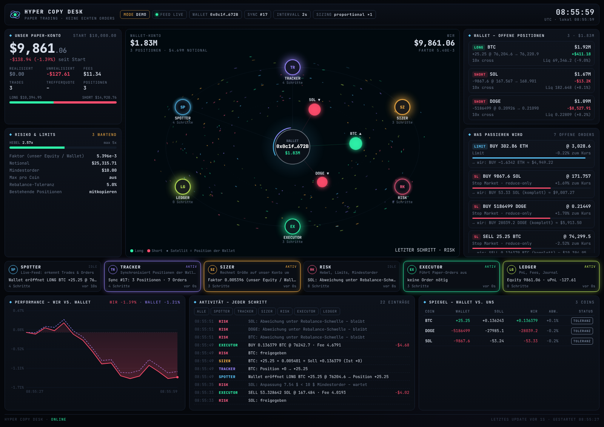

# copy-trading-hyper

Copy-Trading-Bot für **Hyperliquid** in Rust – als **Test-System (Paper Trading)**.
Der Bot folgt standardmäßig der Wallet

```
0x0c1f6941FDcDe9488DfD36cA16FeD6B3bc49672B
```

und spiegelt deren Perp-Positionen auf ein simuliertes Konto. Es werden **keine echten Orders**
gesendet und **kein Private Key** benötigt – es wird nur die öffentliche `/info`-API gelesen.

## Dashboard (Copy Desk)



```bash
cargo run --release -- dashboard --demo      # synthetische Wallet, läuft ohne API
cargo run --release -- dashboard             # live gegen die Wallet
# dann im Browser: http://127.0.0.1:8080
```

Ein Bildschirm für alles, was passiert und passieren wird:

- **Orbit**: Die Wallet im Zentrum, ihre Positionen als Satelliten (Größe = Wert, grün = Long,
  rot = Short), unsere 6 Agenten im Ring. Jeder Schritt fliegt als Lichtimpuls durch die Pipeline.
- **Agenten** (jeder Schritt der Pipeline):
  SPOTTER (Live-Feed) → TRACKER (Positionen syncen) → SIZER (Größe umrechnen) →
  RISK (Hebel, Limits, Mindestorder) → EXECUTOR (Paper-Order) → LEDGER (PnL, Fees, Journal)
- **Was passieren wird**: offene Orders der Wallet (Limit, TP, SL) sortiert nach Abstand zum Kurs,
  jeweils mit dem, was unser Bot tun würde, wenn sie ausgeführt werden.
- **Wallet – offene Positionen**: Größe, Einstieg → Kurs, Wert, uPnL, Hebel, Liquidationspreis.
- **Spiegel**: Wallet-Größe vs. unser Soll vs. Ist, Abweichung und warum ggf. nicht gehandelt wurde.
- **Paper-Konto, Risiko & Limits, Performance-Chart (wir vs. Wallet in %), Aktivitäts-Log** mit Filter pro Agent.

Mit `--listen 0.0.0.0:8080` ist das Dashboard auch vom Handy im selben WLAN erreichbar.

## Trades der Wallet live verfolgen

```bash
cargo run --release -- watch
cargo run --release -- watch --log ziel_trades.csv   # zusätzlich als CSV mitschreiben
```

Zeigt zuerst alle **offenen Positionen** (Größe, Einstieg, Wert, uPnL, Hebel, Liquidationspreis)
und **offenen Orders** (Limit, TP/SL, reduce-only). Danach wird jeder neue Trade sofort gemeldet,
z. B.:

```
[14:03:21] TARGET OPEN LONG     BTC       +0.5000 @ 65000   (32500.00 USDC) -> position +0.5000
[14:20:02] TARGET REDUCE LONG   BTC       -0.2000 @ 66100   (13220.00 USDC) -> position +0.3000  closed PnL +220.00
[14:21:40] TARGET order open    SELL ETH 4 @ 3400 (oid 123456)
```

Technik: Snapshot per REST (`clearinghouseState`, `frontendOpenOrders`), danach WebSocket
`wss://api.hyperliquid.xyz/ws` mit den Subscriptions `userFills` (Ausführungen, Teil-Fills einer
Order werden zusammengefasst) und `orderUpdates` (neue/stornierte/ausgelöste Orders).
Automatischer Reconnect, Ping alle 30 s, funktioniert auch hinter einem HTTPS-Proxy (`HTTPS_PROXY`, `SSL_CERT_FILE`).

## Funktionsweise des Copy-Bots

Alle `--interval` Sekunden:

1. `clearinghouseState` der Ziel-Wallet abrufen (Account Value + Positionen je Coin)
2. `allMids` abrufen (aktuelle Mid-Preise)
3. Soll-Position je Coin berechnen:
   - `proportional` (Standard): `Zielgröße × (mein Equity / Ziel-Equity) × multiplier`
   - `fixed`: `Zielgröße × ratio`
4. Limits anwenden: `--max-leverage` (Gesamt-Notional), `--max-position-usd` (pro Coin)
5. Differenz zur eigenen Paper-Position als Market-Order zum Mid ± Slippage ausführen
   (inkl. Taker-Fee). Orders unter `--min-order-usd` und Mini-Rebalances unter
   `--rebalance-threshold` werden übersprungen; schließt das Ziel einen Coin, wird immer komplett geschlossen.

Zusätzlich zum Polling hört `run` auf den WebSocket-Feed: Sobald die Wallet tradet, wird sofort
synchronisiert statt bis zum nächsten Intervall zu warten (abschaltbar mit `--no-ws`).

Der Kontostand wird in `paper_state.json` gespeichert (Neustart setzt fort), jede simulierte
Ausführung landet in `trades.csv`.

## Nutzung

```bash
# Tests
cargo test

# Offline-Demo-Szenario (kein Netzwerk nötig)
cargo run -- simulate

# Offene Positionen und Orders der Wallet einmalig anzeigen
cargo run -- status

# Live folgen & Paper-traden (1000 USDC Startkapital, max. 5x Hebel)
cargo run --release -- run --balance 1000 --interval 5

# Nur neue Trades kopieren, bestehende Positionen beim Start ignorieren
cargo run --release -- run --skip-existing

# Fester Faktor statt proportional: 1 % der Zielgröße
cargo run --release -- run --sizing fixed --ratio 0.01
```

Andere Wallet: `--wallet 0x...` oder Umgebungsvariable `TARGET_WALLET`.
Alle Optionen: `cargo run -- run --help`. Neu starten mit frischem Konto: `paper_state.json` löschen.

## Aufbau

| Datei | Inhalt |
|---|---|
| `src/hyperliquid.rs` | Read-only Client für die Hyperliquid Info-API |
| `src/ws.rs` | WebSocket-Live-Feed (Trades + Orders der Wallet), Reconnect, Proxy |
| `src/desk/` | Dashboard: Pipeline/Agenten-Zustand, HTTP + Server-Sent Events, Demo-Wallet, Web-Oberfläche |
| `src/engine.rs` | Copy-Logik: Sizing, Limits, Order-Planung |
| `src/paper.rs` | Simuliertes Konto: Fills, Fees, Slippage, PnL |
| `src/mock.rs` | Skript-basierte Offline-Datenquelle + Demo-Szenario |
| `src/journal.rs` | CSV-Trade-Log |
| `tests/scenario.rs` | End-to-End-Test über das Demo-Szenario |

## Grenzen der Simulation

- Ausführung zum Mid-Preis ± fixer Slippage, keine Orderbuch-Tiefe
- Funding-Zahlungen und Liquidationen werden nicht simuliert
- Nur Perps (Haupt-DEX), kein Spot
- Kopiert wird zum Mid-Preis im Moment der Erkennung, nicht zum Ausführungspreis der Wallet
